# Swara

**Virtual harmonium · tuner · riyaz.** A mobile-first web app for harmonium players, built around the
Bina 17 (42 keys, double reed). It has four parts:

- **Tune:** a key-by-key tuner. It listens through the microphone, shows each reed's deviation in cents
  and says which end of the reed tongue to file.
- **Play:** a virtual harmonium with every key at its true pitch.
- **Riyaz:** alankars, ragas and bhajans with a tanpura and tabla.
- **Report:** a report of every reed, for you or a harmonium technician.

The interface is in English, Nepali (नेपाली) and Hindi (हिन्दी).

Built with React and Vite. No backend: readings and settings are stored in the browser (`localStorage`).

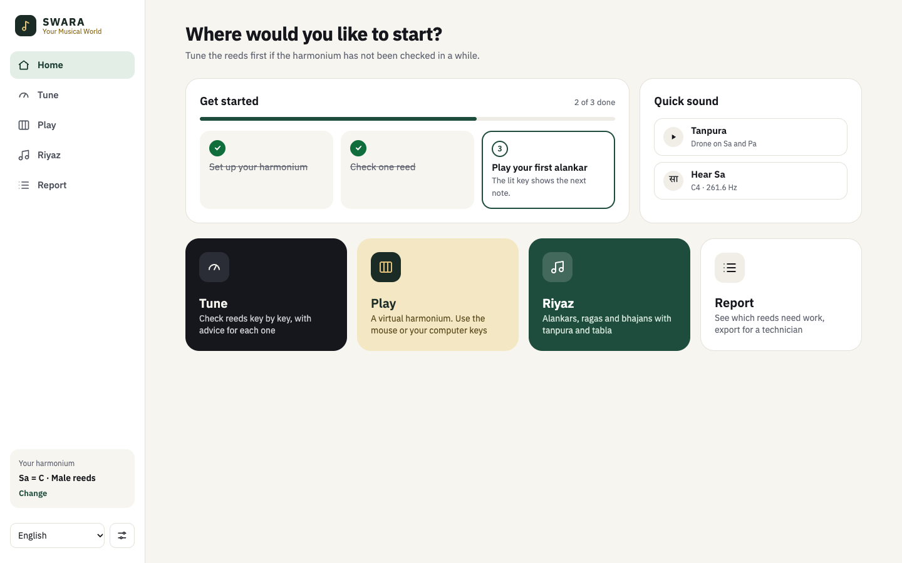

## Features

- **First-run setup.** Three short steps on a phone: language; what to do first, which key is Sa
  (safed 1, kali 1, …) and which reed stops you use; then why the app needs the microphone. On desktop all
  three are on one card. You can skip it and change everything later in Settings.
- **Home.** A *Get started* checklist (set up, check one reed, play your first alankar). When it is done it
  becomes a summary of how many reeds are in tune. Home also has a door into each section and one-tap
  *Tanpura* and *Hear Sa*.
- **Tune.**
  - The live reading shows the swara, the note name, the cents deviation and a ±50¢ meter with the
    tolerance band. On desktop it also shows the measured and target frequency and the steadiness.
  - Every reading comes with plain advice ("Lower it at the root", "Raise it at the tip", "In tune. Leave
    this reed") and progress since the last reading.
  - Bass (16′), Male (8′) and Female (4′) reeds have their own targets and readings. Hold a key steady and
    the reading saves itself. Tapping a key listens for that key only.
  - Each key has a *Key details* sheet: targets on all three banks, *Ideal vs measured*, the full
    step-by-step instructions, saved readings and clearing the key.
  - On a computer, Space saves and ← / → change key.
- **Play.** A virtual harmonium with the Bass, Male and Female stops, as on the real instrument.
  - On a phone the keys stand upright, high notes at the top. *Landscape* opens all 42 keys sideways, full
    screen.
  - On a computer you can also play with the keys A–K (Sa to Sa) and W E T Y U (komal and tivra). Z and X
    change octave; Space releases everything.
  - *Hold notes* lets one tap sound a note until you tap it again, so you can build chords and drones.
    *Highlight a raga* dims the keys outside it. There is a tanpura drone and a volume control.
  - Every key sounds at the pitch your settings give it (A4, equal or just tuning, Sa).
- **Riyaz.**
  - *Alankars:* eight standard patterns in any of the ten thaats, at one to four notes per beat.
  - *Ragas:* twelve common ragas with thaat, jati, vadi/samvadi, time of day, aaroh, avroh and pakad, and
    exercises in each raga's own scale.
  - *Bhajans:* a free jam, six Krishna bhajans with traditional words set to simple practice tunes, and
    your own bhajans typed in sargam.
  - Practice has a full screen of its own:
    - The keyboard lights the note to play and dims notes outside the scale. On a phone it stands upright
      beside the notation, so the keys never scroll out of view.
    - The notation is laid out by taal with sam, tali and khali marks and follows the playhead.
    - One bar holds tempo, play and loop.
    - Everything else is in *Sounds*: the harmonium playing the notes, tanpura, tabla, *Check me with the
      mic* (which marks each note right or wrong), taal, speed of notes and script.
- **Report.** A summary of the bank (in tune, close, off, not checked) and *Fix these first*, the keys
  furthest off first, with the action for each. On desktop it adds a deviation chart and a filterable table
  of every key. You can copy the table to a spreadsheet or export it as CSV.
- **English, Nepali and Hindi.** Everything is translated, including the generated tuning instructions and
  the CSV. Swaras show in Devanagari. The app starts in the device's language, and `/ne/` and `/hi/` always
  open in that language.
- **Phones and desktops.** Phones get a bottom tab bar and upright keyboards; desktops get a sidebar and
  full-width keyboards. Both layouts come from the same components.
- **Themes.** System, Light, White (for bright rooms and printing) and Dark, in Settings.

## Screenshots

**Phone.**

<table>
  <tr>
    <td width="25%">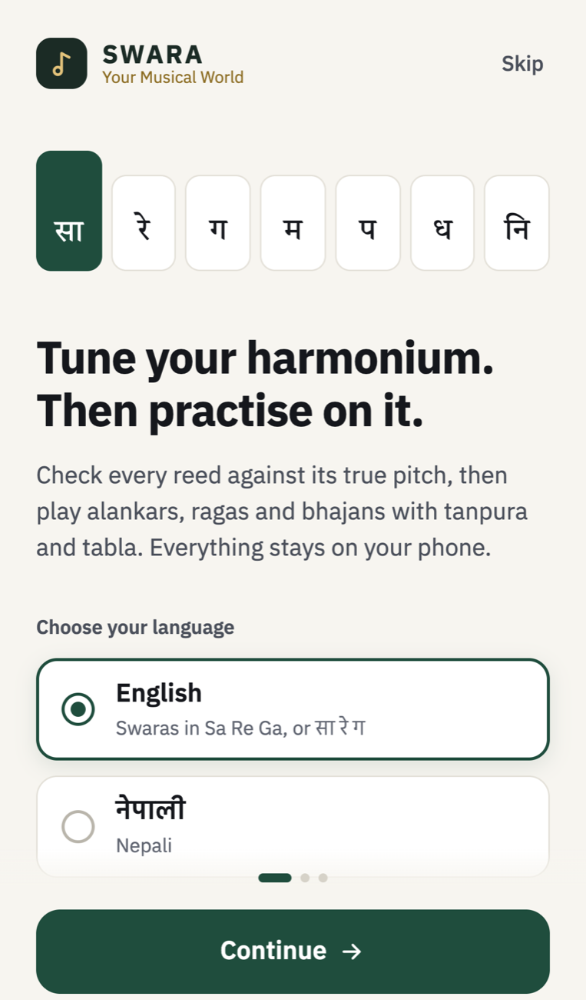</td>
    <td width="25%">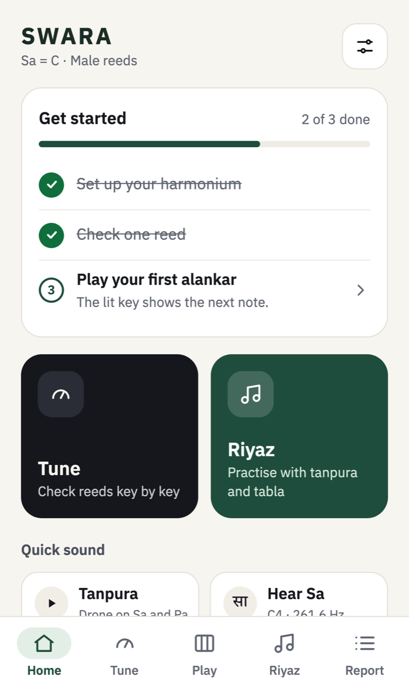</td>
    <td width="25%">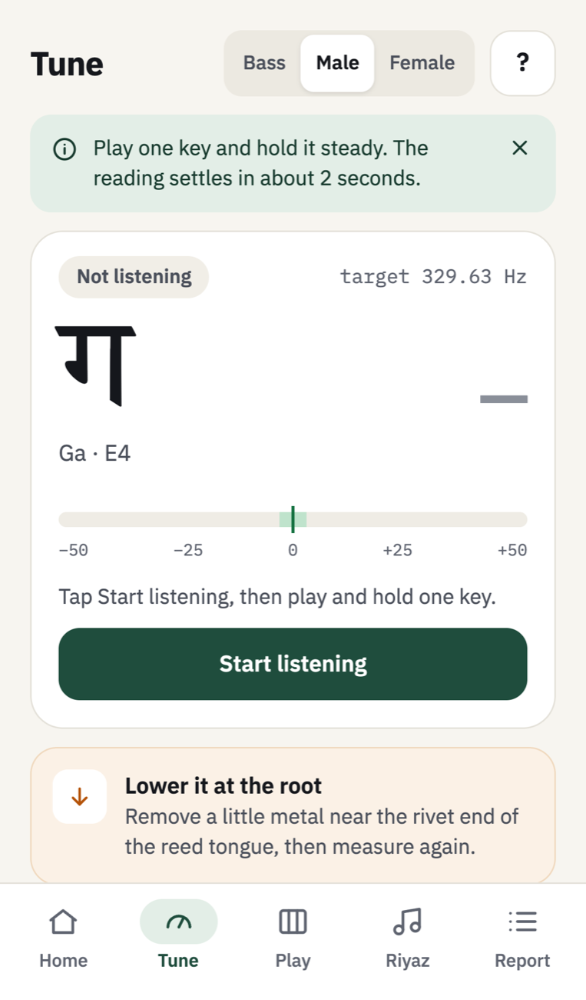</td>
    <td width="25%">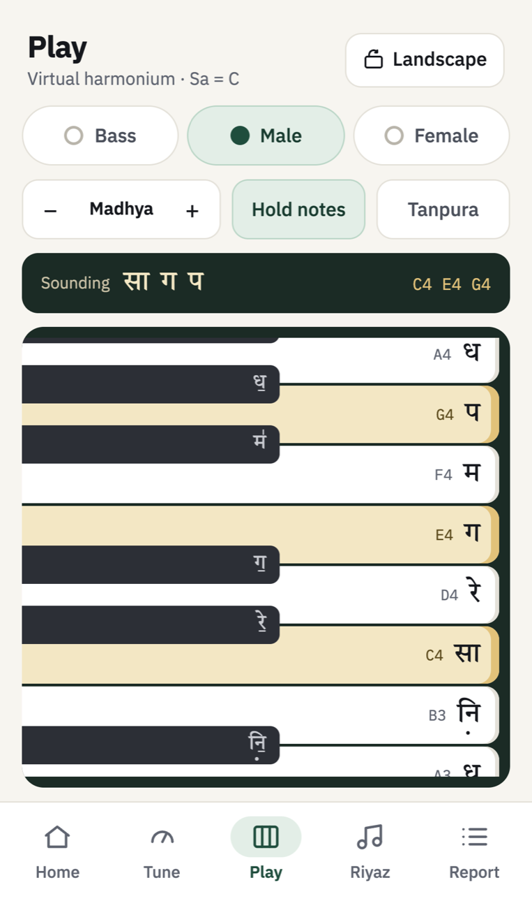</td>
  </tr>
  <tr>
    <td width="25%">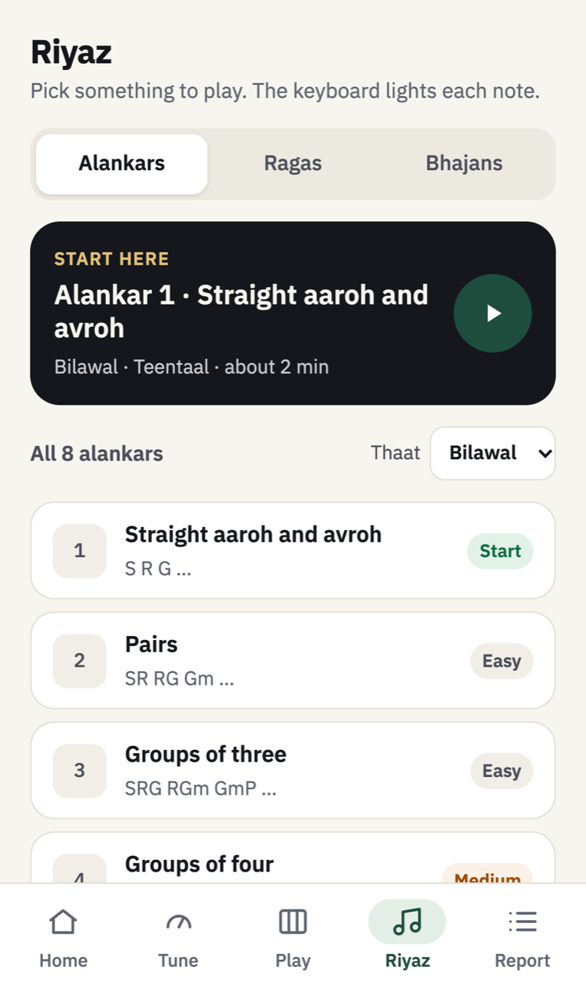</td>
    <td width="25%">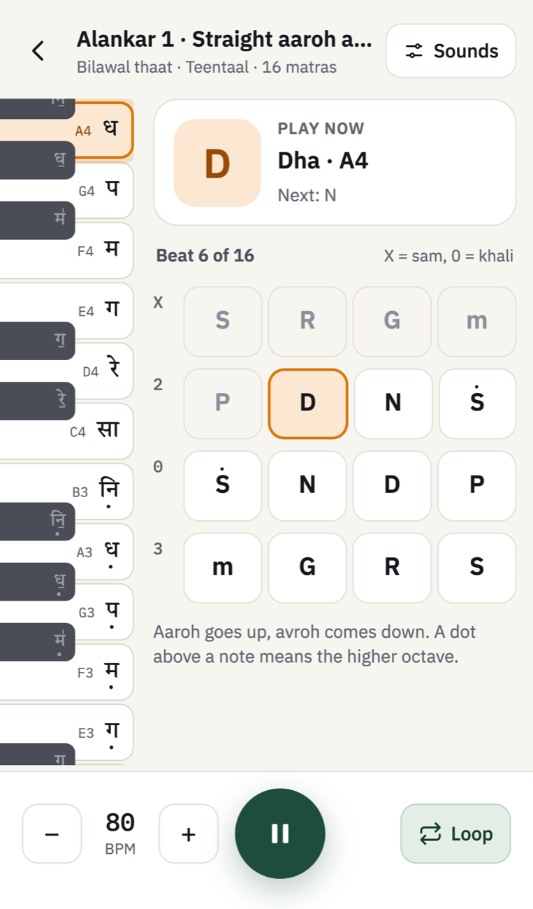</td>
    <td width="25%">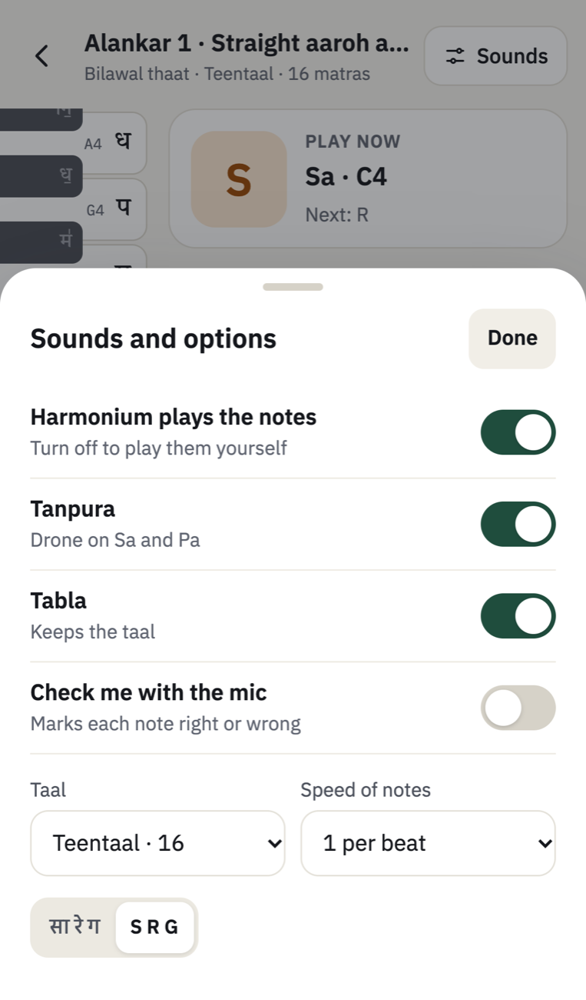</td>
    <td width="25%">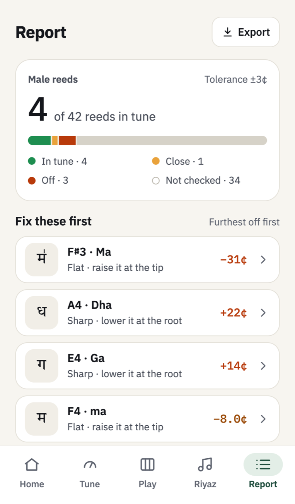</td>
  </tr>
</table>

**Desktop.**

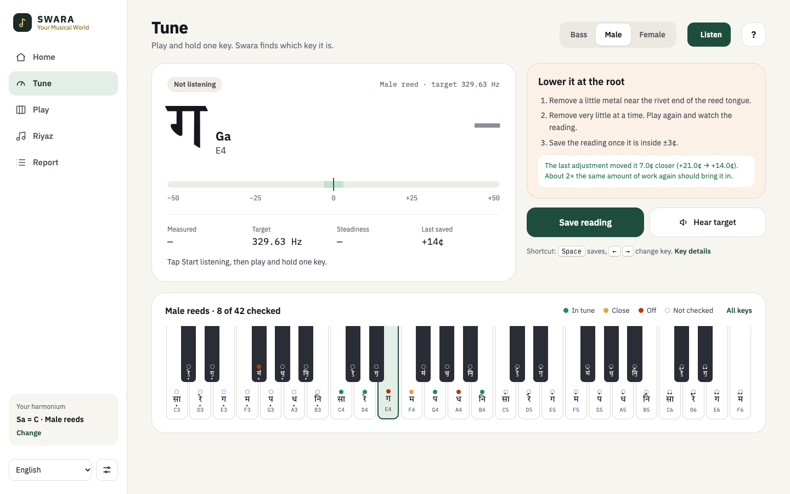

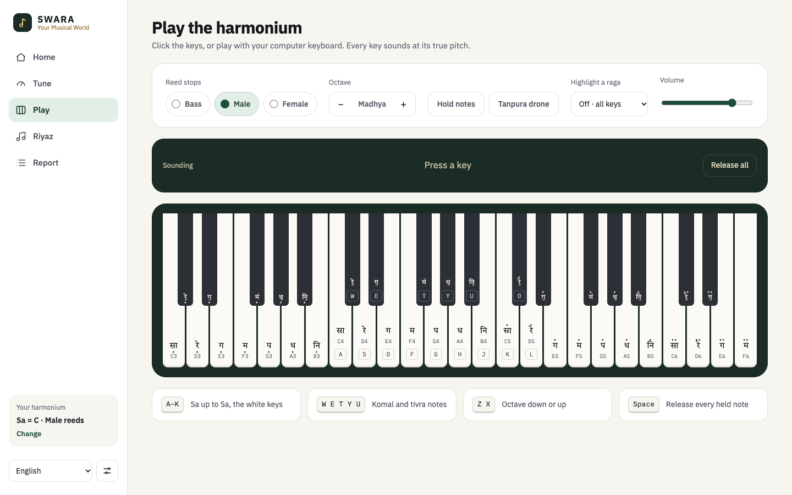

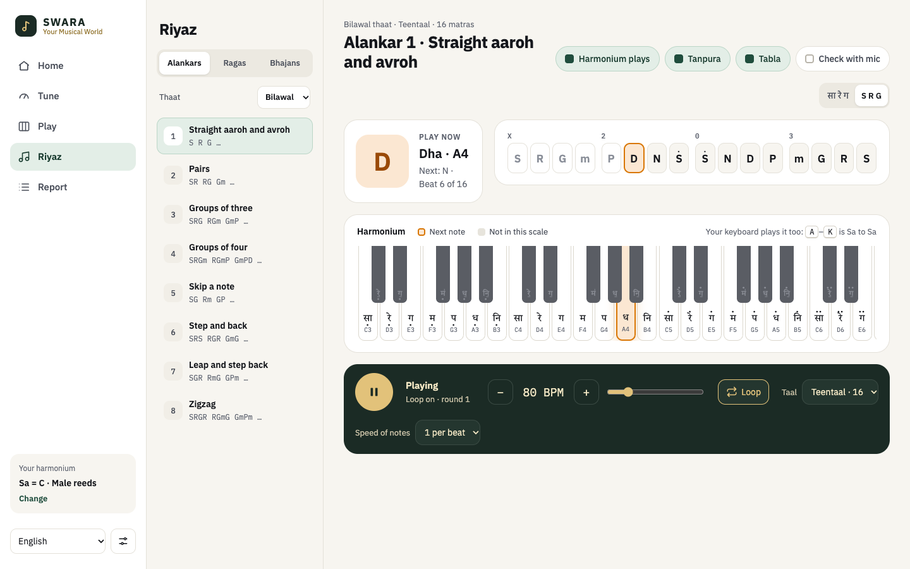

<table>
  <tr>
    <td width="50%">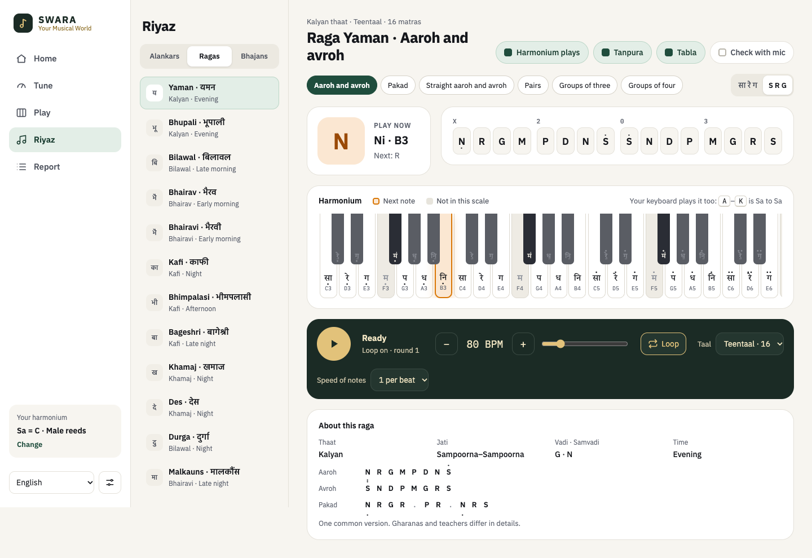</td>
    <td width="50%">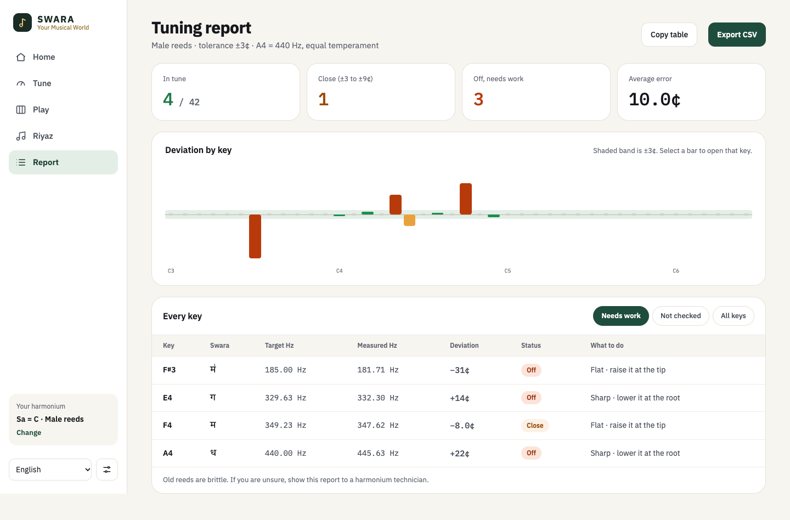</td>
  </tr>
  <tr>
    <td width="50%">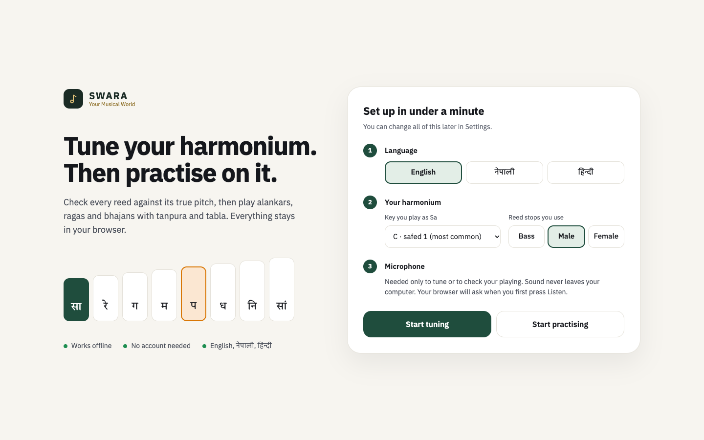</td>
    <td width="50%">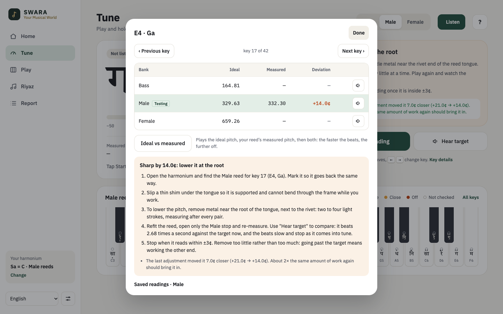</td>
  </tr>
</table>

**Nepali, Hindi and the dark theme.**

<table>
  <tr>
    <td width="20%"></td>
    <td width="60%">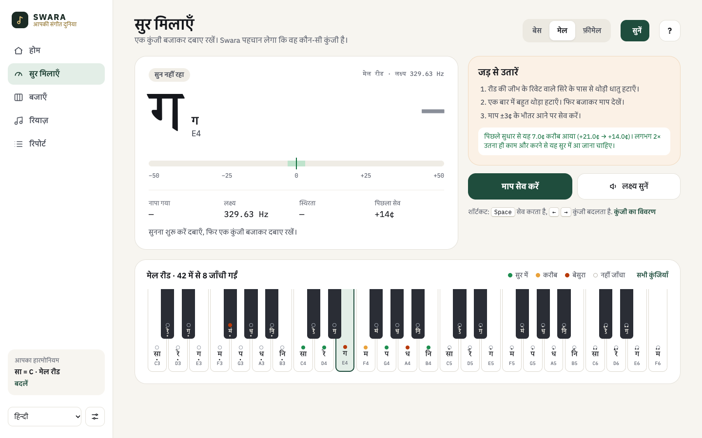</td>
    <td width="20%">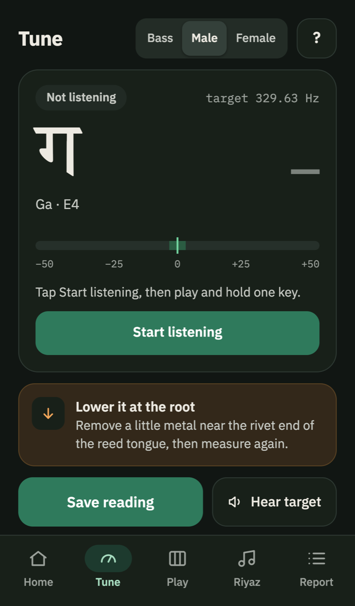</td>
  </tr>
</table>

<details>
<summary>Dark theme on desktop</summary>


</details>

## How to tune with it

1. Open only one reed-bank stop (Bass or Male) and keep the drone stops shut.
2. Choose the same bank at the top of Tune. Place the phone 20–30 cm from the reed board in a quiet room.
3. Press *Start listening*, pump the bellows to your normal playing pressure and hold each key for about two
   seconds. A steady reading saves itself.
4. Work through all 42 keys, then switch banks and repeat. Report lists the keys to fix first.
5. To hear what a key should sound like, use *Hear target*, or play it in Play. *Ideal vs measured* in Key
   details lets you hear the difference: the faster the beats, the further off the reed is.
6. Follow each key's advice. Scrape at the free tip to raise the pitch and near the rivet to lower it, a
   little at a time, measuring after each round. Old reeds are brittle. If you are unsure, take the report
   to a harmonium technician.

## Adding or changing text

All wording is in [src/i18n/messages.js](src/i18n/messages.js) (tuning, instructions, report, Riyaz) and
[src/i18n/ui.js](src/i18n/ui.js) (the app shell and screens), each with `en`, `ne` and `hi` tables of the
same shape. `npm test` fails if a key is missing from any language. To add a language, add a table to both
files, an entry in `LANGUAGES` and a path in `LANG_PATH`; the build then prerenders its pages.

## Run locally

```bash
npm install
npm run dev      # http://localhost:5173
npm test         # pitch detection, tuning maths, instructions, harmonium pitches, translations
npm run build    # production build in dist/
```

The microphone only works on `localhost` or over HTTPS. To test on a phone, use the deployed site.

## Deploy to Vercel

Either:

- Push this folder to a GitHub, GitLab or Bitbucket repository. In Vercel, choose **Add New → Project**,
  import the repository and press **Deploy**. Vercel detects Vite, and `vercel.json` pins the build command
  and output folder.
- Or, from this folder, run `npx vercel` for the first deploy and a preview, then `npx vercel --prod`.

Vercel serves over HTTPS, so the microphone works on phones. `vercel.json` also sends
`Permissions-Policy: microphone=(self)`.

## Search engines and sharing

`npm run build` prerenders real HTML for every section in every language, so search engines and link
previews see the full page without running JavaScript:

- `/`, `/tune/`, `/play/`, `/riyaz/` and `/report/`, and the same under `/ne/` and `/hi/`. Each has its own
  title, description, canonical link and `hreflang` links to the other languages.
- Open Graph and Twitter tags with a preview image (`public/og-image.png`), and `WebApplication`
  structured data
- `robots.txt`, `sitemap.xml` and a web app manifest, so Swara can be installed to a phone's home screen

Absolute URLs (canonical, `hreflang`, `og:image`, sitemap) need the site's public address. On Vercel the
build reads it from `VERCEL_PROJECT_PRODUCTION_URL`. To use a custom domain, or to build elsewhere, set
`SITE_URL`:

```bash
SITE_URL=https://swara.example.com npm run build
```

After deploying, add the site in [Google Search Console](https://search.google.com/search-console) and
[Bing Webmaster Tools](https://www.bing.com/webmasters), and submit `https://<your-domain>/sitemap.xml`.

## Project layout

```
src/
  App.jsx                 routing between the five sections, onboarding, shared audio and dialogs
  components/Nav.jsx      brand mark, desktop sidebar and phone tab bar
  components/Onboarding.jsx  first-run setup (three steps on phones, one card on desktops)
  components/Home.jsx     get-started checklist, section doors, quick sounds
  components/Tune.jsx     live reading, meter, advice, key strip / keyboard and the key details sheet
  components/Play.jsx     the virtual harmonium, its controls and the landscape view
  components/Riyaz.jsx    exercise library, practice screen, notation, raga facts and the bhajan editor
  components/Report.jsx   summary, fix-first list, deviation chart, table and export
  components/Keys.jsx     every keyboard in the app, flat or upright, for tuning, playing and practice
  components/Sheet.jsx    bottom sheet on phones, centred dialog on desktops
  lib/dsp.js              YIN pitch detection, key targets (equal / just)
  lib/instructions.js     per-key tuning instructions built from the readings
  lib/report.js           CSV and copy-to-spreadsheet report
  lib/format.js           formatting, per-key status, short actions
  lib/harmonium.js        reed-like Web Audio voices at each key's ideal pitch
  lib/music.js            thaats, ragas, taals, alankar patterns and the sargam notation parser
  lib/practice.js         riyaz audio: tanpura, tabla theka and notation playback, scheduled ahead
  lib/audio.js            the shared AudioContext and master volume
  hooks/useTuner.js       microphone, detection loop, steady-hold auto-save
  hooks/useHarmonium.js   playing the harmonium (pointer, computer keys), pauses detection meanwhile
  hooks/usePractice.js    riyaz transport for React, playhead and the mic check
  hooks/useDrone.js       a tanpura drone outside Riyaz (Home and Play)
  hooks/useMedia.js       the phone / desktop layout switch
  hooks/useTuningStore.js settings, onboarding, theme, language and saved readings, in localStorage
  i18n/messages.js        tuning, instruction, report and Riyaz text in English, Nepali and Hindi
  i18n/ui.js              app shell and screen text in English, Nepali and Hindi
src/entry-server.jsx      renders the app to HTML for prerendering
scripts/prerender.mjs     writes every language's pages, head tags, robots.txt and sitemap.xml after the build
tests/                    accuracy (within 0.1 cent from C2 to F6), instructions, harmonium, music data and translation tests
docs/screenshots/         images used in this README
```
