# Bina 17 Tuner

A mobile-first, key-by-key tuner for the Bina 17 harmonium (42 keys, double reed). It listens through the
microphone and shows each key's deviation in cents, beat rate and steadiness. It saves a reading per key and
reed bank, then gives step-by-step tuning instructions for every key based on what it measured: direction
and amount, steadiness, the reed's register, progress since the last reading, agreement with the other reed
bank, and whether the whole instrument sits at a different pitch. It also includes a reference harmonium,
so you can hear how every key should sound. The interface is available in English, Nepali (नेपाली) and Hindi (हिन्दी).

Built with React and Vite. No backend: readings are stored in the browser (`localStorage`).

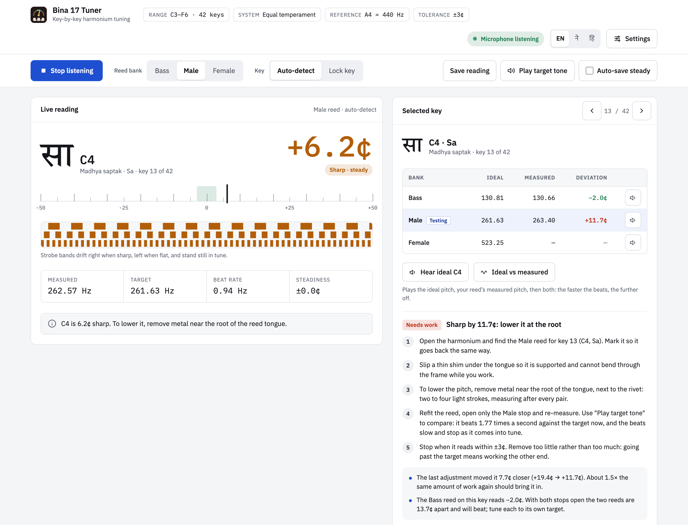

## Features

- **Live reading.** Shows the swara in Devanagari, the Western note name and the cents deviation, with a
  strobe and a ±50¢ meter. Also shows measured and target frequency, beat rate and steadiness.
- **Three reed banks.** Bass (16'), Male (8') and Female (4') each get their own targets and readings.
- **Find the key automatically, or lock one.** Hold a key steady for about a second and the reading saves
  itself.
- **Equal temperament or just intonation.** Uses 5-limit just ratios from a Sa you choose, with A4
  adjustable.
- **Instructions for each key.** Tells you which end of the reed tongue to work and roughly how much. It
  also reports overshoot and progress from earlier readings, and warns when the reed banks disagree.
- **Reference harmonium.** Switch the keyboard to *Play harmonium* to hear every key at its ideal pitch.
  Pull out the Bass, Male and Female stops like on the real instrument, play chords, or use the computer
  keys A–K. The pitches follow your settings for A4, tuning system and Sa.
- **Ideal vs measured.** On any key, hear the ideal pitch, then your reed's measured pitch, then both
  together. The beating you hear is how far off the reed is.
- **Report.** Shows summary figures and a deviation chart for all keys, then a table with each key's status
  and the action to take. Copy it to a spreadsheet or export it as CSV.
- **English, Nepali and Hindi.** Switch with the EN / ने / हि buttons in the app bar (a dropdown on phones).
  Everything is translated, including the generated tuning instructions and the CSV report; swaras show in
  Devanagari. It starts in the device's language, and `/ne/` and `/hi/` always open in that language.
- **Landscape keyboard on phones.** The *Landscape* button on the keyboard opens all 42 keys at once, full
  screen and sideways, so there is no scrolling. It works in Inspect and Play modes. Where the browser
  allows it the screen locks to landscape; otherwise (iPhone) the view turns itself and you turn the phone.
- **Status by shape as well as colour** (dot, ring, diamond, dashed ring), so it reads without colour vision.
- **Themes.** System (follows the device), Light, White (pure white, for bright rooms and printing) and Dark,
  in Settings.

## Screenshots

<table>
  <tr>
    <td width="50%">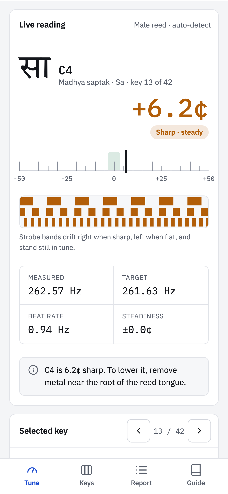</td>
    <td width="50%">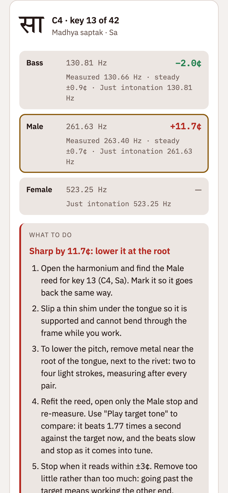</td>
  </tr>
  <tr>
    <td align="center"><sub>Live reading on a phone</sub></td>
    <td align="center"><sub>What to do for the selected key</sub></td>
  </tr>
</table>

**Keyboard.** Each of the 42 keys shows its last reading and a status marker. Tap a key to inspect it.

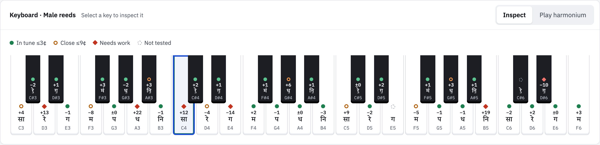

**Reference harmonium.** The same keyboard in Play mode, with the Bass and Male stops out and a C major
chord held.

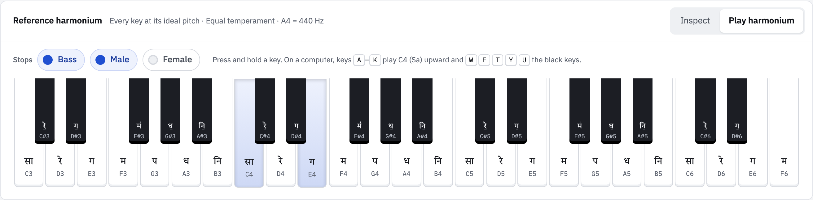

<table>
  <tr>
    <td width="50%">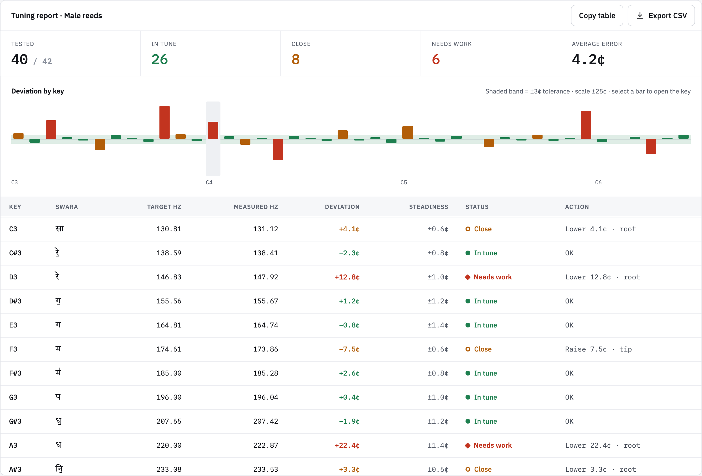</td>
    <td width="50%">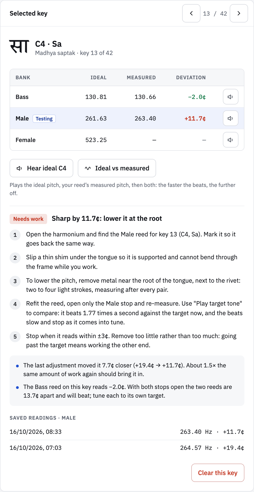</td>
  </tr>
  <tr>
    <td align="center"><sub>Report with deviation chart</sub></td>
    <td align="center"><sub>Key detail: ideal pitch, listen buttons, what to do</sub></td>
  </tr>
</table>

**Landscape keyboard on a phone.** All 42 keys at once, here playing a chord on the reference harmonium.

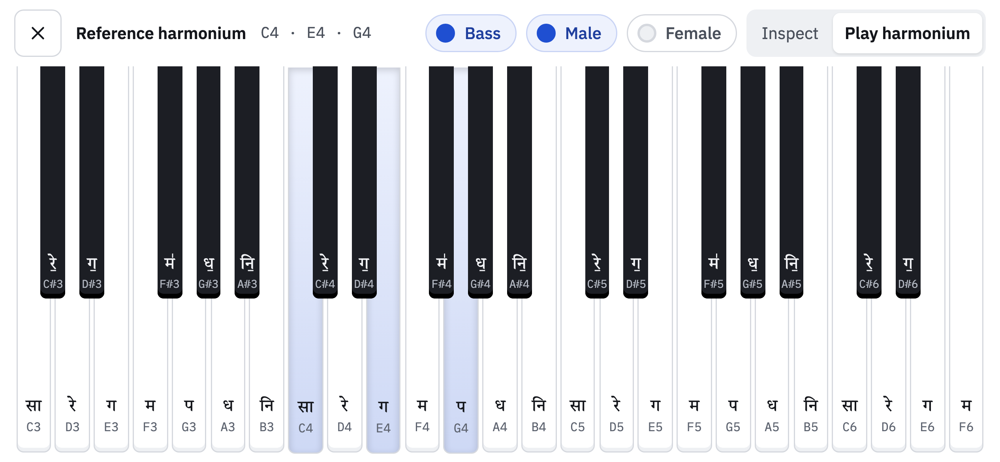

**Nepali, Hindi and the White theme.**

<table>
  <tr>
    <td width="60%">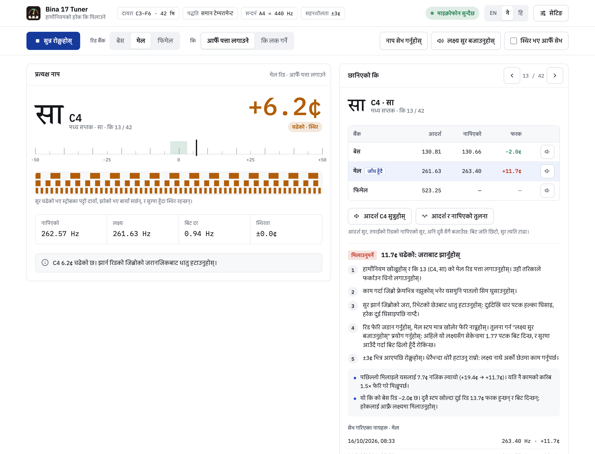</td>
    <td width="20%">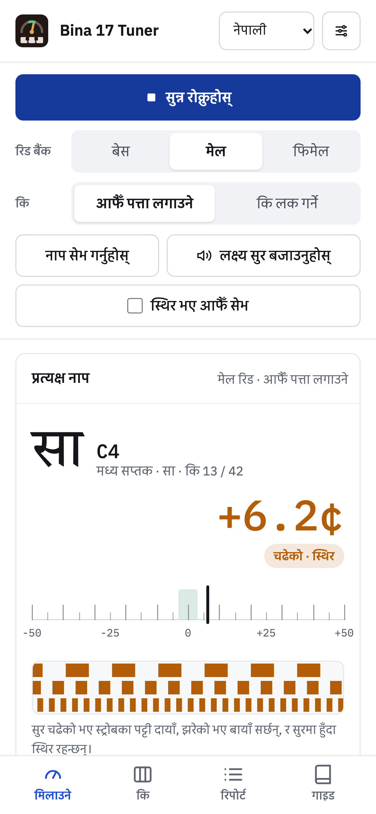</td>
    <td width="20%">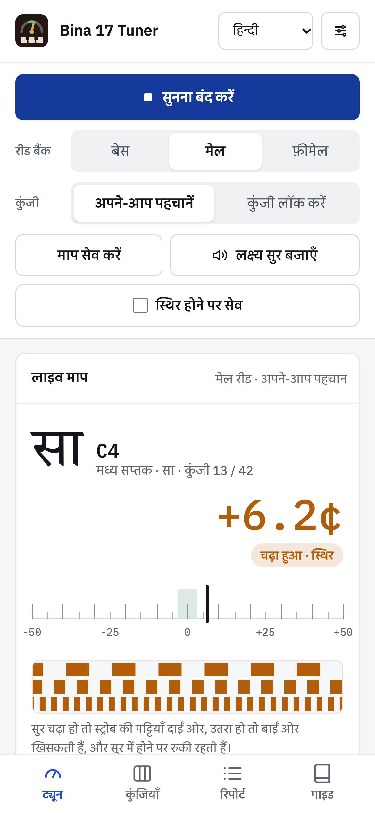</td>
  </tr>
</table>

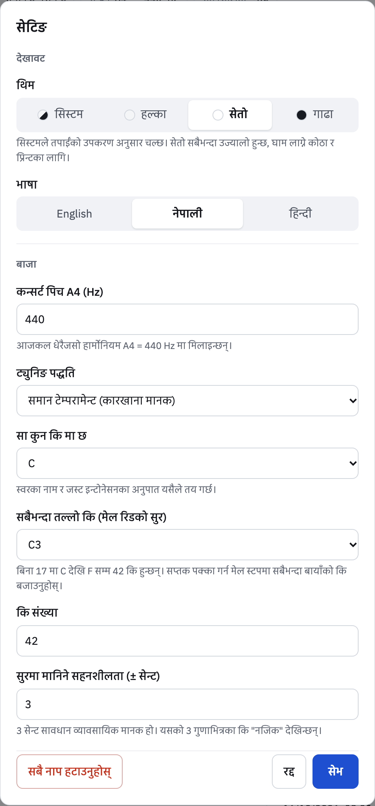

<details>
<summary>Dark theme</summary>

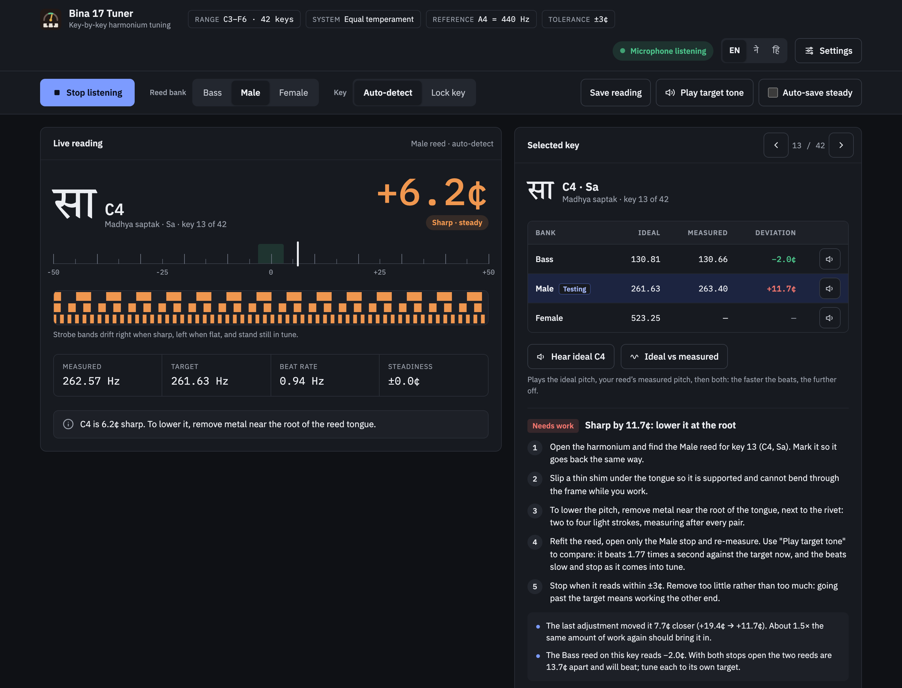

</details>

## How to tune with it

1. Open only one reed-bank stop (Bass or Male) and keep the drone stops shut.
2. Select the same bank in the app. Place the phone 20–30 cm from the reed board in a quiet room.
3. Pump the bellows to your normal playing pressure and hold each key for about two seconds.
4. Work through all 42 keys, then switch banks and repeat.
5. To hear what a key should sound like, use *Hear ideal* on the key, or play it on the reference harmonium.
   *Ideal vs measured* lets you hear the difference: the faster the beats, the further off the reed is.
6. Follow each key's instructions. Scrape at the free tip to raise the pitch and near the rivet to lower
   it, a little at a time, measuring after each round. Old reeds are brittle. If you are unsure, take the
   report to a harmonium technician.

## Adding or changing text

All wording is in [src/i18n/messages.js](src/i18n/messages.js), with `en`, `ne` and `hi` tables of the same
shape. `npm test` fails if a key is missing from any language. To add a language, add a table, an entry in
`LANGUAGES` and a path in `LANG_PATH`; the build then prerenders a page for it.

## Run locally

```bash
npm install
npm run dev      # http://localhost:5173
npm test         # pitch detection, tuning maths, instructions, harmonium pitches, translations
npm run build    # production build in dist/
```

The microphone only works on `localhost` or over HTTPS. To test on a phone, use the deployed site.

## Deploy to Vercel

Either:

- Push this folder to a GitHub, GitLab or Bitbucket repository. In Vercel, choose **Add New → Project**,
  import the repository and press **Deploy**. Vercel detects Vite, and `vercel.json` pins the build command
  and output folder.
- Or, from this folder, run `npx vercel` for the first deploy and a preview, then `npx vercel --prod`.

Vercel serves over HTTPS, so the microphone works on phones. `vercel.json` also sends
`Permissions-Policy: microphone=(self)`.

## Search engines and sharing

`npm run build` prerenders real HTML for each language, so search engines and link previews see the full
page without running JavaScript:

- `/` (English), `/ne/` (Nepali) and `/hi/` (Hindi), each with its own title, description, canonical link and `hreflang`
  links to the other languages
- Open Graph and Twitter tags with a preview image (`public/og-image.png`), and `WebApplication`
  structured data
- `robots.txt`, `sitemap.xml` and a web app manifest, so the tuner can be installed to a phone's home screen

Absolute URLs (canonical, `hreflang`, `og:image`, sitemap) need the site's public address. On Vercel the
build reads it from `VERCEL_PROJECT_PRODUCTION_URL`. To use a custom domain, or to build elsewhere, set
`SITE_URL`:

```bash
SITE_URL=https://tuner.example.com npm run build
```

After deploying, add the site in [Google Search Console](https://search.google.com/search-console) and
[Bing Webmaster Tools](https://www.bing.com/webmasters), and submit `https://<your-domain>/sitemap.xml`.

## Project layout

```
src/
  lib/dsp.js              YIN pitch detection, key targets (equal / just), reed advice
  lib/instructions.js     per-key tuning instructions built from the readings
  lib/report.js           CSV and copy-to-spreadsheet report
  lib/format.js           formatting, per-key status, short actions
  lib/harmonium.js        reference harmonium: reed-like Web Audio voices at each key's ideal pitch
  hooks/useTuner.js       microphone, detection loop, steady-hold auto-save
  hooks/useHarmonium.js   playing the reference harmonium (pointer, computer keys), pauses detection meanwhile
  hooks/useTuningStore.js settings, theme, language and saved readings, persisted to localStorage
  i18n/messages.js        every user-facing string in English, Nepali and Hindi
  i18n/I18n.jsx           language context for components
  components/             Readout, Strobe, Meter, Controls, Keyboard, KeySheet, Instructions, Report, ...
src/entry-server.jsx      renders the app to HTML for prerendering
scripts/prerender.mjs     writes /, /ne/, /hi/, head tags, robots.txt and sitemap.xml after the build
tests/                    accuracy (within 0.1 cent from C2 to F6), instructions, harmonium and translation tests
docs/screenshots/         images used in this README
```
